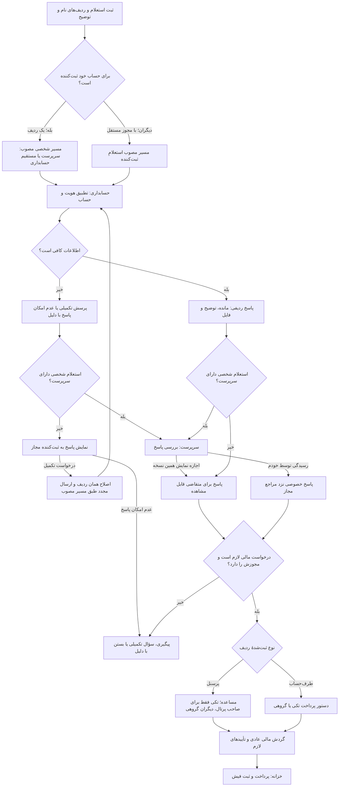

# گردش مانده حساب و صورت‌حساب — v71

این راهنما مربوط به نسخهٔ آزمایشی است. استعلام با درخواست پرداخت مستقل است؛ دیدن مانده، اجازه یا سقف پرداخت ایجاد نمی‌کند.

## فرم ثبت

بالای فرم: نوع «پرسنل (مساعده)» یا «طرف‌حساب (دستور پرداخت)»، شرکت، اطلاعات موردنیاز و تاریخ/بازه. جدول: نام فرد یا طرف‌حساب و توضیح ثبت‌کننده. نامِ شناخته‌شده را می‌توان از پیشنهادها انتخاب کرد؛ نامِ بدون حساب پرتال دستی نوشته می‌شود و حساب کاربری تازه‌ای ایجاد نمی‌کند.

## فلو کلی

## چه کسی چه کاری می‌تواند انجام دهد؟

| شخص یا دسترسی | ثبت استعلام | دیدن پاسخ | ساخت مالی |
|---|---|---|---|
| متقاضی تکی | فقط برای خودش؛ نام ثابت | پس از اجازهٔ مرجع، مگر مسیر مستقیم مصوب | فقط نوع مالی مجاز خودش |
| متقاضی گروهیِ دارای مجوز استعلام دیگران | نام‌های دستی در شرکت مجاز؛ انتخاب افراد ثبت‌شده فقط در محدوده مجاز | استعلام‌های خودش و پاسخ‌هایی که مراجع مجاز ارائه کرده‌اند | در حدود فرم‌های مالی مجاز او |
| سرپرست | برای خودش و افراد مجاز؛ استعلام هنگام بررسی مالی | پاسخ‌های مرتبط با اقدام/ثبت خودش | فقط اگر مجوز مالی مربوط را هم داشته باشد |
| سرپرست بدون ثبت مالی | استعلام و بررسی طبق مجوز مستقل | پاسخ‌های مجاز همان مسیر | نقش سرپرست به‌تنهایی مجوز ساخت مالی نمی‌دهد |
| فرد بدون حساب پرتال | خودش وارد سامانه نمی‌شود؛ شخص مجاز برای او ردیف می‌سازد | صرف آمدن نامش، پاسخ برای او منتشر نمی‌شود | توسط ثبت‌کنندهٔ مجاز |
| حسابداری | پاسخ‌گویی ردیفی و سؤال تکمیلی | استعلام‌های شرکت و محدودهٔ مجاز | پاسخ حسابداری، تأیید مالی نیست |
| خزانه | طبق مجوز استعلام جداگانه، نه صرفاً نقش خزانه | صورت‌حساب خصوصی از طریق پرداخت به او نمی‌رسد | پرداخت تنها از صف رسمی و مجوز عادی |
| مدیر اصلی | تنظیم دسترسی/مسیر، حالت امن و جانشینی موردی با دلیل | استعلام‌های شرکت‌های مجاز؛ مجوز مدیریت برای اقدامات مدیریتی جدا کنترل می‌شود | اختیار و سابقهٔ مالی عادی همچنان لازم است |

## ریزفلو متقاضی تکی

۱. نام خودش ثابت است؛ نوع، شرکت، اطلاعات و تاریخ‌ها را می‌بیند و توضیح می‌نویسد. افزودن نام دیگر مجاز نیست.
۲. سرپرست تعیین‌شده، اجازهٔ ارسال به حسابداری می‌دهد؛ برگشت یا رد، دلیل می‌خواهد.
۳. حسابداری هویت و حساب را تطبیق و پاسخ/فایل را ثبت می‌کند. حسابدار پاسخ استعلام خودش را نهایی نمی‌کند.
۴. همان مرجع پاسخ را می‌بیند و جداگانه اجازهٔ نمایش می‌دهد یا خودش رسیدگی می‌کند.
۵. پاسخ تازه، اجازهٔ نسخهٔ قدیمی را به ارث نمی‌برد. مسیر مستقیم به حسابداری فقط با انتخاب صریح مدیر است.

## ریزفلو متقاضی گروهی و نیروی بدون پرتال

۱. ثبت‌کننده باید مجوز مستقل «استعلام دیگران» داشته باشد؛ ثبت پرداخت گروهی به‌تنهایی پاسخ خصوصی دیگران را آشکار نمی‌کند.
۲. برای هر شخص یا طرف‌حساب یک نام و توضیح می‌نویسد. نام دستی به فرد هم‌نام متصل نمی‌شود. انتخاب شخص موجود با شناسه، شرکت، واحد و زیرمجموعه در سرور کنترل می‌شود.
۳. استعلام از مسیر مصوب خودِ ثبت‌کننده می‌گذرد. ثبت‌کننده با محدودهٔ مالی «فقط خود» می‌تواند با همین مجوز مستقل برای نام‌های دستی یا نیروهای ثبت‌شدهٔ زیرمجموعه استعلام بسازد؛ محدودهٔ مالی او وسیع نمی‌شود.
۴. حسابداری نام و حساب را تشخیص می‌دهد؛ اگر نام کافی نیست، مشخصات تکمیلی می‌خواهد. مانده از پرداخت‌های پرتال حدس زده نمی‌شود.
۵. هر ردیف مستقل پاسخ می‌گیرد. پاسخ برای ثبت‌کننده و مراجع مرتبط است؛ شخص موضوعِ ردیف، صرفاً به‌علت آمدن نامش آن را نمی‌بیند.
۶. استعلام حساب خودِ ثبت‌کننده در یک فرم جدا و شخصی ثبت می‌شود تا مسیر محرمانگی آن حفظ شود.

استعلام دیگران هم ابتدا از مرجع تعیین‌شدهٔ ثبت‌کننده عبور می‌کند، مگر مدیر مسیر مستقیم حسابداری را انتخاب کرده باشد. پس از پاسخ حسابداری، ثبت‌کنندهٔ مجاز آن را می‌بیند؛ اجازهٔ نمایش جداگانه مخصوص استعلام شخصیِ دارای سرپرست است. پرسش تکمیلی حسابداری نیز برای همان استعلام شخصی تا اجازهٔ مرجع مخفی می‌ماند و اصلاح روی همان ردیف انجام می‌شود؛ «عدم امکان پاسخ» خودکار استعلام تازه نمی‌سازد.

## ریزفلو سرپرست و چندنقشی

درخواست خودش از مسیر مستقل استعلام خودش می‌رود و نقش سرپرست باعث خودتأییدی نمی‌شود. درخواست نیروها در مرجع ثبت‌شده رسیدگی می‌شود. هنگام بررسی مالی نیز می‌تواند روی ردیف‌های مجاز، خصوصی از حسابداری سؤال کند؛ گردش تأیید و پرداخت همان سند متوقف نمی‌شود. پاسخ دیرهنگام، مبلغ یا پرداخت قبلی را بازنویسی نمی‌کند.

## ساخت مالی و رفت‌وبرگشت

- دریافت پاسخ یا بازکردن فرم هیچ پرداختی ایجاد نمی‌کند؛ فرمان نهایی جدا، مبلغ و مشخصات بانکی می‌خواهد.
- نوع «طرف‌حساب» به دستور پرداخت تبدیل می‌شود و نمی‌توان با دست‌کاری فرم آن را مساعده کرد.
- نوع «پرسنل» مساعده می‌سازد: تکی فقط برای صاحب پرتال؛ برای دیگری، فرم گروهی حتی با یک ردیف. در نام دستی، ثبت‌کنندهٔ مجاز پرسنلی‌بودن را صریحاً تأیید می‌کند و سابقه ثبت می‌شود.
- ردیف‌های قدیمیِ بدون نوع جدید، معنای قبلی خود را نگه می‌دارند. هیچ پاسخ یا پرداختی بازطبقه‌بندی نمی‌شود.
- تغییر نام/هویت یا نوع، قبل از ساخت مالی از اصلاح رسمی و بررسی دوباره می‌گذرد؛ پاسخ قبلی برای هدف قبلی در تاریخچه می‌ماند و برای هدف تازه قابل تبدیل نیست.
- هر ردیف فقط یک ردیف مالی می‌سازد؛ تکرار کلیک، قطع پاسخ و دو نشست، هدف مالی دوم ایجاد نمی‌کنند. پرداخت جزئی روی همان هدف مالی ادامه دارد.

## تنظیم دسترسی

مجوز شخصی، استعلام دیگران، تأیید اولیه، پاسخ حسابداری، اجازهٔ نمایش، ساخت مالی و زیرمنوها مستقل‌اند. فقط حساب‌ها و نقش‌های مصنوعیِ Stage برای آزمون این فلو آماده می‌شوند؛ این راهنما مجوز فعال‌سازی کاربران واقعی یا انتشار دامنه نیست.
